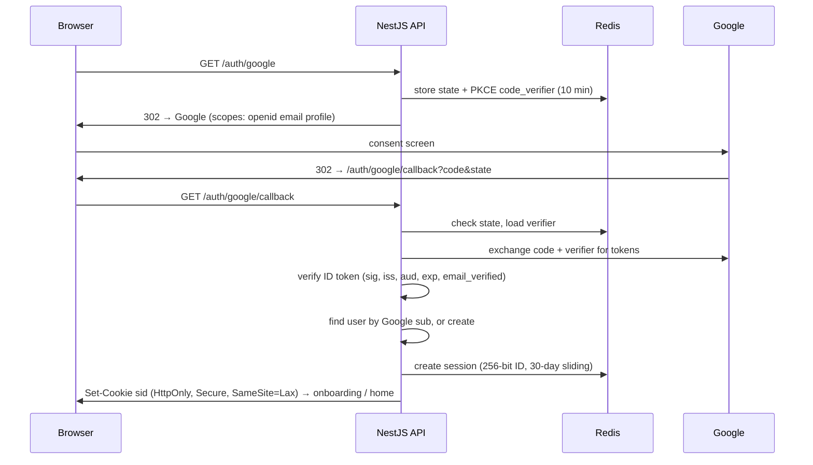

# Book Club Platform — Web Architecture

> **Status:** Phase 1 built for local development · **Owner:** Aman Chaturvedi · **Last updated:** 2026-10-20
> Companion doc: [Business Plan](business-plan.md) · Change history: [CHANGELOG](../CHANGELOG.md)

---

## 1. Overview and Phase 1 scope

Phase 1 is a responsive web app built as a **modular monolith** on **Next.js + NestJS + PostgreSQL**, with Google sign-in only, sized for a solo developer and up to ~50k users without re-architecture.

### Goals

- Ship Phase 1 in 12–16 weeks with one developer.
- Keep running costs under ₹15,000/month until ~5k users.
- Design the API so the Phase 2 mobile apps (React Native) reuse it unchanged.
- Privacy by default: no precise user location stored, DMs limited to people who share a club.

### In scope for Phase 1

- Google OAuth sign-in, user profiles, onboarding (city, languages, favourite genres)
- Book catalog and search; book pages with "Buy" affiliate links
- "I'm reading this" with progress, plus aggregate counts on book and club pages
- Clubs: create, join, roles, invites, current book, reading schedule, polls
- Spoiler-safe discussion threads gated by reading progress
- Club-scoped direct messages
- Events: create, RSVP, list by city (no map yet)
- Goodreads / StoryGraph CSV import
- Notifications: in-app, email, WhatsApp reminders
- Bookstore directory (basic listings, no stock data)

### Out of scope for Phase 1

Mobile apps, payments and paid tiers, blogs, map views, video meetings, recommendations beyond simple "popular in your city".

## 2. System architecture

One API serves every client; a worker handles background jobs.

```mermaid
flowchart TB
    Browser["Web browser"]
    Mobile["Mobile app (Phase 2)"]
    CF["Cloudflare: DNS, CDN, TLS · R2 image storage"]

    subgraph AWS["AWS Mumbai (ap-south-1)"]
        Web["Next.js web<br/>SSR pages, UI"]
        API["NestJS API<br/>REST + WebSocket"]
        Worker["Worker<br/>BullMQ background jobs"]
        PG[("PostgreSQL<br/>Core data")]
        Redis[("Redis<br/>Sessions, queues, limits")]
        Meili[("Meilisearch<br/>Book and club search")]
    end

    subgraph Ext["External services"]
        Google["Google sign-in"]
        BookAPIs["Book data APIs"]
        WA["WhatsApp API"]
        SES["Email (SES)"]
    end

    Browser --> CF
    Mobile -.-> CF
    CF --> Web
    CF --> API
    Web --> API
    API --> PG
    API --> Redis
    API --> Meili
    Worker --> PG
    Worker --> Redis
    Worker --> Meili
    AWS --> Ext
```



All traffic enters through Cloudflare. The Next.js server renders public pages for SEO and calls the NestJS API, which owns all business logic and permissions. A worker built from the same codebase runs imports, counters, re-indexing and notifications, and talks to Google, book-data sources, WhatsApp and email.

## 3. Tech stack

One language (TypeScript) end to end, managed services wherever they save ops time.

| Layer | Choice | Why |
|---|---|---|
| Web frontend | Next.js (App Router), React, Tailwind CSS | SSR for SEO on book, club and event pages; huge ecosystem |
| Backend API | NestJS (Node.js, TypeScript), REST + OpenAPI | Modular monolith, typed contracts shared with web and future mobile apps |
| Realtime | Socket.IO gateway inside NestJS, Redis adapter | Live thread updates and DMs; scales across instances |
| Database | PostgreSQL 16 (managed) + Prisma ORM | Relational data, full-text search fallback, pgvector later for recommendations |
| Cache, queues | Redis + BullMQ | Sessions, rate limits, counters, background jobs |
| Search | Meilisearch (self-hosted) | Typo-tolerant book and club search; easy to run |
| Object storage | Cloudflare R2 + CDN | Covers and avatars; no egress fees |
| Auth | Google OAuth 2.0 / OpenID Connect, server-side sessions | Simple, trusted sign-in for Indian users |
| Email | Amazon SES or Resend | Transactional email |
| WhatsApp | WhatsApp Cloud API (Meta) | Event and schedule reminders with user opt-in |
| Hosting | AWS Mumbai (ap-south-1), or Railway/Render to start | Low latency for Indian users; data stays in India |
| Monitoring | Sentry, Grafana Cloud or Better Stack | Errors, logs and uptime on free tiers |
| CI/CD | GitHub Actions, Docker | Test, build and deploy on every merge |

### Repository layout

Monorepo (pnpm + Turborepo):

```
apps/
  web/        # Next.js
  api/        # NestJS (also builds the worker entry point)
  mobile/     # React Native — added in Phase 2
packages/
  shared/     # Types and Zod validation schemas
```

## 4. Authentication: Google OAuth

Users sign in only with Google, using the OAuth 2.0 Authorization Code flow with PKCE, handled by the API; the browser gets an **HttpOnly session cookie, never a token**.

### Sign-in flow (web)



1. User clicks "Continue with Google"; the web app sends them to `GET /auth/google` on the API.
2. The API creates a random `state` and a PKCE `code_verifier`, stores them in Redis for 10 minutes, and redirects to Google with scopes `openid email profile`.
3. Google shows the consent screen and redirects back to `GET /auth/google/callback?code=…&state=…`.
4. The API checks `state`, exchanges the code (with the verifier) for tokens, and verifies the ID token: signature, `iss`, `aud` = our client ID, `exp`, and `email_verified`.
5. The API finds the user by Google `sub` (not email, which can change), or creates one with name, email and photo.
6. The API creates a session in Redis (random 256-bit ID, 30-day sliding expiry) and sets cookie `sid`: `HttpOnly`, `Secure`, `SameSite=Lax`, scoped to the app domain.
7. New users go to onboarding (city, languages, genres, consent to terms); returning users go to their home feed.

### Design decisions

- We don't store Google access or refresh tokens: we need only identity, not Google APIs.
- `user_identities` table (provider, provider_user_id) lets us add phone OTP or email login later without migrating users.
- Logout deletes the Redis session; "log out everywhere" deletes all sessions for the user.
- State-changing requests require the session cookie plus a CSRF token header.
- Rate-limit sign-in endpoints per IP.

**Setup in Google Cloud Console:** create an OAuth client (Web application), add the callback URLs for local, staging and production, and publish the consent screen with the app name, logo, privacy policy and terms links. The basic scopes above don't need Google's sensitive-scope review.

**Phase 2 (mobile):** the app uses the native Google Sign-In SDK and sends the ID token to `POST /auth/google/token`; the API verifies it the same way and returns a short-lived access token plus a rotating refresh token. If the iOS app offers Google login, Apple also requires an equivalent privacy-focused option such as Sign in with Apple — plan for it then.

## 5. Data model

About 25 PostgreSQL tables cover Phase 1. Conventions: all IDs are **UUIDv7** (time-ordered), all timestamps **UTC**, user content is **soft-deleted**.

| Table | Key columns | Notes |
|---|---|---|
| `users` | id, display_name, email, avatar_url, city, languages[], bio, created_at, deleted_at | City is the only location stored; no coordinates |
| `user_identities` | user_id, provider, provider_user_id (unique) | `google` + Google `sub` in Phase 1 |
| `user_settings` | user_id, notify_email, notify_whatsapp, whatsapp_number, dm_policy | WhatsApp only with explicit opt-in |
| `books` | id, title, subtitle, language, description, cover_url, page_count, published_year, source | Our own catalog; `source` = openlibrary / google / user / import |
| `book_editions` | id, book_id, isbn13, isbn10, format, publisher, language | Links translations and editions to one work |
| `authors`, `book_authors` | id, name, name_native; book_id, author_id | Native-script names for regional authors |
| `book_links` | book_id, retailer, url, last_price_inr, checked_at | Amazon/Flipkart affiliate links; Phase 2 adds store stock |
| `reading_status` | user_id, book_id, status (want / reading / read), progress_pct, current_chapter, started_at, finished_at, rating | "I'm reading this" = status `reading` |
| `clubs` | id, name, slug, description, city, language, visibility (public / private), owner_id, current_book_id | Public clubs are listed and indexed for SEO |
| `club_members` | club_id, user_id, role (owner / admin / member), joined_at | Unique (club_id, user_id) |
| `club_books` | club_id, book_id, starts_on, ends_on, schedule (JSON: chapters per week) | History of everything the club has read |
| `polls`, `poll_options`, `poll_votes` | club_id, question, closes_at, kind (book / time / general) | One vote per member (ranked voting in Phase 2) |
| `threads` | id, club_id, book_id, title, chapter_gate, author_id, created_at | `chapter_gate` = the chapter you must reach to see it |
| `posts` | id, thread_id, author_id, body, chapter_ref, edited_at, deleted_at | Replies inherit the thread's gate unless higher |
| `dm_conversations`, `dm_participants`, `dm_messages` | conversation_id, user_id, body, created_at, read_at | Only between people who share a club |
| `events` | id, club_id (nullable), bookstore_id (nullable), title, starts_at, ends_at, mode (online / in_person), venue_name, area, city, meeting_url, capacity | `area` = neighbourhood text; no lat/long in Phase 1 |
| `event_rsvps` | event_id, user_id, status (going / maybe / no) | Waitlist when capacity is reached |
| `bookstores` | id, name, address, area, city, lat, lng, phone, website, hours, claimed_by | Public businesses, so coordinates are fine |
| `notifications` | id, user_id, type, payload (JSON), read_at | In-app feed |
| `reports`, `blocks` | reporter_id, target_type, target_id, reason; blocker_id, blocked_id | Trust and safety from day one |

**Aggregate counters** ("14 readers in your city are reading this") come from `book_stats(book_id, city, reading_count, clubs_reading_count)`, refreshed by a background job every 15 minutes. Counts below 5 show as "a few readers" so no one can be singled out.

## 6. API design

A versioned REST API (`/v1`) documented with OpenAPI, plus one WebSocket channel for live updates; web and future mobile apps use the same endpoints.

| Area | Key endpoints |
|---|---|
| Auth | `GET /auth/google`, `GET /auth/google/callback`, `POST /auth/logout`, `GET /v1/me` |
| Users | `PATCH /v1/me`, `GET /v1/users/:id`, `DELETE /v1/me` (account deletion) |
| Books | `GET /v1/books/search?q=`, `GET /v1/books/:id`, `GET /v1/books/:id/stats?city=`, `GET /v1/books/:id/buy-links` |
| Reading status | `PUT /v1/me/books/:bookId` (status, progress, chapter), `GET /v1/me/books?status=reading` |
| Import | `POST /v1/me/import` (CSV upload → job id), `GET /v1/me/import/:jobId` |
| Clubs | `POST /v1/clubs`, `GET /v1/clubs?city=&language=&q=`, `GET /v1/clubs/:slug`, `POST /v1/clubs/:id/join`, `POST /v1/clubs/:id/invites`, `PATCH /v1/clubs/:id/members/:userId` |
| Club reading | `POST /v1/clubs/:id/books`, `PUT /v1/clubs/:id/books/:clubBookId/schedule` |
| Polls | `POST /v1/clubs/:id/polls`, `POST /v1/polls/:id/votes` |
| Discussion | `GET /v1/clubs/:id/threads`, `POST /v1/clubs/:id/threads`, `GET /v1/threads/:id/posts?cursor=`, `POST /v1/threads/:id/posts` |
| DMs | `GET /v1/dms`, `POST /v1/dms` (recipient must share a club), `GET /v1/dms/:id/messages`, `POST /v1/dms/:id/messages` |
| Events | `GET /v1/events?city=&from=&to=`, `POST /v1/events`, `POST /v1/events/:id/rsvp` |
| Bookstores | `GET /v1/bookstores?city=&area=`, `GET /v1/bookstores/:id` |
| Safety | `POST /v1/reports`, `POST /v1/blocks`, `DELETE /v1/blocks/:userId` |
| Notifications | `GET /v1/notifications`, `POST /v1/notifications/read` |

**Conventions:**
- Cursor pagination on every list.
- Zod schemas in `packages/shared` validate requests on the API and type the client.
- Errors as `{ code, message, details }`.
- Authorization checked in a guard per route (club role, membership, DM eligibility).

**Realtime:** clients connect to `/ws` with the session cookie and join rooms such as `thread:<id>` and `dm:<id>`. The server pushes new posts, messages and typing indicators only to members who pass the same permission checks as the REST API.

## 7. Key feature designs

The hard parts are the book catalog, spoiler gating and DM permissions; the rest is standard CRUD.

### 7.1 Book catalog and search

- **Seeding:** look up books on demand by ISBN or title from Open Library and Google Books, and save results into our own `books` table so we never depend on one source.
- **Enrichment:** users can add missing books (with a review queue); Goodreads imports add titles our readers actually own.
- **Search:** Meilisearch indexes title, subtitle, author names (Latin and native script) and ISBNs; a worker re-indexes on every change. Postgres full-text search is the fallback if Meilisearch is down.
- **Buy links:** build Amazon India affiliate URLs from the ISBN-10/ASIN with our associate tag; Flipkart and others added as programs approve us. Pages carry an affiliate disclosure.

### 7.2 Spoiler-safe discussion

- Every thread has a `chapter_gate`. A reader sees the thread title and posts only if their `current_chapter` for that book is at least the gate; otherwise they see "Unlocks at chapter 7".
- The check happens **on the server in the query** (`WHERE chapter_gate <= :userChapter`), never only in the UI.
- Club schedules create default threads per week ("Chapters 1–5") automatically.
- Posts can also hide a sentence behind a spoiler tag that readers tap to reveal.

### 7.3 "I'm reading this" and aggregate counts

- Button on every book page sets `reading_status = reading`; readers update progress by percent or chapter.
- A job every 15 minutes recomputes `book_stats` per book and city. Pages show "14 readers in &lt;city&gt; · 3 clubs reading this"; tapping lists the **clubs**, not individual readers.
- Counts under 5 display as "a few readers". No individual reader appears on any public list in Phase 1.

### 7.4 Club-scoped DMs

- `POST /v1/dms` succeeds only if sender and recipient share at least one club and neither has blocked the other.
- If they stop sharing a club, the conversation becomes read-only.
- Limits: 20 new conversations per day per user, stricter for accounts younger than 7 days. Images and links disabled in the first message.
- Report and block from any conversation; reported messages go to a moderation queue with context.

### 7.5 Events

- Events belong to a club or a bookstore; online events carry a meeting link shown only to people who RSVP.
- In-person events show venue name and neighbourhood publicly; the exact address can be limited to RSVPs.
- City listing pages ("Book events in &lt;city&gt; this week") are server-rendered for SEO.
- An `.ics` calendar file and reminders go out 24 hours and 2 hours before.

### 7.6 Goodreads / StoryGraph import

- User uploads the CSV export; a BullMQ job parses it, matches each row by ISBN, then by title + author, and creates missing books.
- Shelves map to statuses (read, currently-reading, to-read); ratings and dates carry over. The user sees a summary with unmatched rows to fix by hand.

### 7.7 Notifications

- One notification service writes to the in-app feed, then fans out to email and WhatsApp based on user settings.
- WhatsApp uses pre-approved message templates for event reminders and weekly schedule nudges, sent only to users who opted in.
- A daily email digest replaces per-post emails to avoid spam.

## 8. Security, privacy and compliance

Collect the minimum, keep it in India, and make safety features part of Phase 1 rather than an afterthought.

### Application security

- HttpOnly, Secure, SameSite cookies; CSRF tokens on state-changing requests; strict CORS to our own origins.
- Input validated with Zod on every endpoint; Prisma parameterised queries; user content rendered as sanitised Markdown (no raw HTML).
- Content Security Policy, HSTS and standard security headers via Next.js and the load balancer.
- Rate limits in Redis per IP and per user on sign-in, posting, DMs and reports.
- Authorization in one place (NestJS guards) and covered by tests: club role, membership, thread gate, DM eligibility.
- Secrets in AWS Secrets Manager or the host's secret store; dependency scanning (Dependabot) and an annual third-party penetration test once revenue allows.

### Privacy by design

- From Google we store only name, email, photo and `sub`.
- No precise user location: city on the profile, neighbourhood text on events. Coordinates exist only for public bookstores.
- Aggregate counts with a minimum threshold of 5; no public list of individual readers.
- WhatsApp number stored only after explicit opt-in, and deletable at any time.

### DPDP Act 2023 and IT Rules

- Clear notice and consent at onboarding; a privacy policy listing what we collect and why.
- Self-serve account deletion (`DELETE /v1/me`): personal data removed within 30 days, posts anonymised, backups expire on their normal cycle.
- Data export on request (JSON of profile, shelves, posts).
- Grievance officer named in the terms, with a report-and-takedown process for user content.
- Data hosted in AWS Mumbai; breach-response runbook ready before launch.

## 9. Infrastructure, deployment and observability

Start on a single small setup in Mumbai and grow by resizing, not redesigning.

### Phase 1 deployment (AWS ap-south-1)

- Web (Next.js) and API (NestJS) as Docker containers on one ECS Fargate service each, **or** a single Lightsail/EC2 instance with Docker Compose for the cheapest start.
- RDS PostgreSQL (db.t4g.micro → small) with automated daily backups and 7-day point-in-time recovery.
- ElastiCache Redis or a Redis container for sessions, queues and rate limits.
- Meilisearch in a container with a persistent volume.
- Cloudflare in front for DNS, CDN, TLS and basic DDoS protection; R2 for images.
- Worker process (same API image, different entry point) runs BullMQ jobs: imports, stats, notifications, re-indexing.

### Environments

| Environment | Runs on | Deploys |
|---|---|---|
| Local | Docker Compose | — |
| Staging | AWS | Auto-deploys from `main` |
| Production | AWS | On tagged release |

Database migrations run through Prisma in the release pipeline.

**CI/CD (GitHub Actions):** lint, type-check, unit and integration tests (Postgres and Redis in service containers), build images, push to ECR, deploy.

### Observability

- Sentry for frontend and backend errors.
- Structured JSON logs shipped to Grafana Cloud or Better Stack.
- Uptime checks on the web app, API health endpoint and WebSocket gateway.
- Product analytics with PostHog (self-hosted or cloud free tier) for funnels: sign-up → join club → first post.

## 10. Scaling path and costs

The same architecture carries the platform to about 50k monthly active users; beyond that we add replicas and split out hot paths. Costs are approximate monthly estimates in INR.

| Stage | Users | Setup changes | Approx. cost |
|---|---|---|---|
| Launch | 0–5k | Single instance or 1 Fargate task each; db.t4g.micro; Redis container | ₹8,000–15,000 |
| Traction | 5k–50k MAU | 2+ API tasks behind a load balancer; managed Redis; larger DB; separate worker | ₹25,000–60,000 |
| Scale | 50k–500k MAU | Read replica; WebSocket gateway as its own service; Meilisearch cluster; CDN caching for public pages | ₹1–3 lakh |

**What to watch first:** WebSocket connections and fan-out (move to a dedicated gateway), the `posts` table (partition by month if it grows past tens of millions of rows), and WhatsApp message spend (batch reminders into digests).

**Phase 2 additions:** React Native app sharing `packages/shared`; Razorpay subscriptions and payouts; pgvector for recommendations; PostGIS for the aggregate neighbourhood map.

## 11. Phase 1 build plan

Phase 1 reaches private beta in 16 weeks. The schedule assumes one developer working about **20 hours a week** alongside a full-time job; at full time it compresses to roughly 8–10 weeks. Each milestone ends deployed to staging so design partners can try it early.

| Weeks | Milestone | Deliverables | Done |
|---|---|---|---|
| 1–2 | Foundation | Monorepo, CI/CD, staging on AWS Mumbai, Google sign-in, sessions, onboarding | Built (staging not deployed yet) |
| 3–5 | Books and reading | Catalog and search, book pages, buy links, "I'm reading this", Goodreads import | Built |
| 6–9 | Clubs and discussion | Clubs, roles, invites, schedules, polls, spoiler-gated threads, realtime posts | Built |
| 10–12 | Social and events | Club-scoped DMs, events and RSVPs, bookstore directory, notifications, WhatsApp | Built |
| 13–14 | Safety and polish | Reports, blocks, rate limits, privacy policy, account deletion, load tests | Built (load tests and legal review pending) |
| 15–16 | **Private beta** | 10 design-partner clubs across launch communities; fix, measure, prepare the public launch | [ ] |

## 12. Implementation notes

What the code in `apps/` and `packages/` does differently from, or in addition to, the plan above. Keep this section current as the code changes.

**Running it:** see the README. Local services run in Docker on ports 5433 (Postgres), 6380 (Redis), 7700 (Meilisearch) and 1025/8025 (Mailpit, a dev inbox that catches all email).

**Additions not in the original plan**

- **Dev sign-in.** `POST /auth/dev-login` signs in by email without Google, enabled only when `DEV_LOGIN=true` and refused outright in production. It exists so the app is usable before Google OAuth credentials are set up.
- **Moderation console.** `/admin` (site admins only, set via `ADMIN_EMAILS`) shows the report queue with context and the review queue for user-added books. Endpoints: `GET /v1/admin/reports`, `POST /v1/admin/reports/:id/resolve`, `GET /v1/admin/books/pending`, `POST /v1/admin/books/:id/review`.
- **Extra tables:** `club_invites` (invite links with expiry and use limits) and `import_jobs` (Goodreads/StoryGraph import progress and unmatched rows). `dm_conversations.pair_key` guarantees one conversation per pair of people. 29 tables in total.
- **Extra endpoints:** `GET /v1/me/home` (home feed), `GET /v1/cities` and `/v1/cities/:city` (city landing pages), `GET /v1/me/clubs`, `GET /v1/me/bookstores`, `GET /v1/me/export`, `GET /v1/me/blocks`, `GET /v1/events/:id/ics`, `GET /v1/events/:id/rsvps` (host attendance list), `POST /v1/polls/:id/close`, club leave/delete, and invite preview/accept.
- **Spoiler tags:** `||text||` in posts renders as tap-to-reveal.
- **Club message board.** One board per club (`threads.is_board`), a general feed of posts with one level of comments (`posts.parent_id`). Endpoints: `GET/POST /v1/clubs/:id/board`, `POST /v1/posts/:id/replies` (comments respect the same membership, spoiler and block rules). Members can no longer create ad-hoc threads from the UI; book talk goes in the weekly threads.
- **Community blog (brought forward from Phase 2).** `blog_posts` with Markdown bodies, cover and inline photos (attached via `media.blog_post_id` so cleanup keeps them), tags, drafts, likes (`blog_likes`, denormalised `like_count` for "Most loved"). Accounts younger than 7 days publish into `pending` for review; blog posts are reportable. Endpoints under `/v1/blog`.
- **Admin portal (`/ops`).** Separate from reader auth: credentials from `OPS_EMAIL`/`OPS_PASSWORD` (compared in constant time, 5 attempts per 15 min per IP), its own Redis session in an HttpOnly `SameSite=Strict` cookie with its own CSRF token, 8-hour sliding expiry. Without a portal session every `/ops` API route returns 404 and the page shows only a sign-in form; nothing on the site links to it and it's disallowed in robots.txt. Every action is written to `admin_actions`. Deactivating a user sets `suspended_at`, ends all their sessions and blocks sign-in; shutting a club down soft-deletes it with a reason and notifies members (restorable). Active-user metrics come from a throttled `last_active_at` plus one Redis HyperLogLog per India-time day (`dau:YYYY-MM-DD`).
- **Reactions and comment threads.** Posts and comments take 👍/❤️ reactions (`post_reactions`, toggled via `POST /v1/posts/:id/reactions`). Comments nest to any depth via `parent_id`; `root_id` points at the top-level post so `GET /v1/board-posts/:id` loads a whole thread in one query. The feed returns comment counts only.
- **Photo uploads.** `POST /v1/media` accepts one image (≤10 MB), re-encodes it with sharp to WebP (max 1600px edge, camera orientation applied), which drops all EXIF metadata including GPS — consistent with "no precise location". Board posts attach up to 4 by id. Files live in `UPLOAD_DIR` (default `apps/api/uploads`) and are served at `MEDIA_BASE_URL` (`/media`); `StorageService` is the single place to switch to Cloudflare R2 for production. A daily job removes uploads never attached to a post.
- **Book archive.** Threads for earlier books stay listed under Book discussion (`?book=<bookId>`) and remain open for posting; spoiler gates still apply until the reader marks the book finished.
- **Recommendations and the "get matched" quiz.** `/discover/quiz` asks seven questions: reading level, genres, languages, books they loved (added to the "read" shelf), goals, club format and pace, and book length. Answers are stored in `reading_profiles`; genres and languages stay on `users`. `GET /v1/me/recommendations` returns clubs, books and (for new or occasional readers) short "starter" books, each with plain-language reasons. Scoring is rule-based and works without the quiz. It uses:
  - shelves and ratings, including Goodreads imports;
  - the books of every club the reader belongs to, current and past;
  - "readers who liked X also read Y" (co-reading over `reading_status`);
  - same-author matches and city or India-wide popularity (`book_stats`);
  - for clubs: city or online versus preferred format, language, the current book's genres, overlap with the reader's want-to-read and read books, pace versus chapters per week, activity in the last 14 days, and descriptions that welcome new readers.

  Books already on a shelf or being read in the reader's clubs are excluded by title, so other editions don't slip through. `books.genres` uses the shared genre list: it is set from Open Library subjects and Google categories on lookup, and backfilled with `pnpm --filter @bnw/api genres:backfill`. Endpoints: `GET/PUT /v1/me/reading-profile`, `GET /v1/me/recommendations`. New accounts go from onboarding into the quiz, which can be skipped; the home page leads with "Let's find your first book club" until the reader has a club, a book or a profile.
- **Books page and enrichment.** `GET /v1/books` browses the catalogue ordered by readers, then clubs, then title. It filters by `genre` and `language`, and with `q` it ranks results through the normal search path. On each page it hides extra editions that share a title and first author.

  Search (`/v1/books/search` and `?q=`) works in three tiers:
  1. Meilisearch, which is typo-tolerant and covers title, subtitle, authors in English and native script, and ISBNs.
  2. Postgres `ILIKE` when Meilisearch is down.
  3. Open Library, then Google Books, when we find fewer than 5 results. New books found this way are saved into our catalogue.

  Because external search results have no description, `CatalogService.enrich` fills empty fields from the Open Library work record and then Google Books, and stamps `books.enriched_at`. It runs as a `search/enrich` job when a book is saved, and inline (with a timeout) the first time an unenriched book is opened.
- **Waitlist promotion:** when someone with a seat drops out, the first person on the waitlist is moved in and notified.

**Deviations**

- **Worker runs inside the API in dev** (`RUN_WORKER_IN_API=true`) to save memory. In production run `node dist/worker.js` as its own process from the same image, as planned. The realtime service relays worker events to sockets through Redis pub/sub.
- **Meilisearch is called over its REST API** rather than through the JS client, so client/server version drift can't break search. Postgres search takes over automatically whenever Meilisearch is down.
- **Realtime posts are pushed as ids, not content.** Clients refetch over REST, so per-post spoiler gates (`chapter_ref`) apply to live updates too.
- **Search falls back to Open Library, then Google Books,** when local results are thin; new books are saved into our catalog and de-duplicated by external id, ISBN, and title+author.
- **Account deletion is immediate** rather than "within 30 days": personal data is cleared at once, posts are kept but anonymised, and owned clubs pass to the next admin.

**Not built yet (Phase 1 gaps)**

- OpenAPI document generation (the API uses shared Zod schemas, but `/docs` isn't published yet).
- Dockerfiles and the AWS deploy pipeline. CI (typecheck, tests, build) is in `.github/workflows/ci.yml`.
- Load tests, Sentry/PostHog wiring, and legal review of the terms and privacy templates.
- WhatsApp message templates must be registered with Meta (`event_reminder`, `weekly_schedule_nudge`). Until credentials are set, messages are logged instead of sent.
