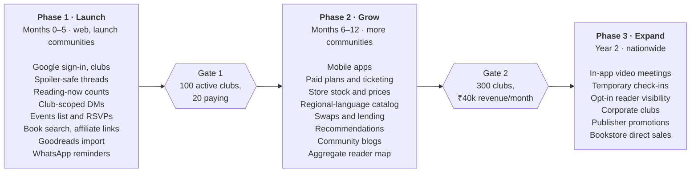

# Book Club Platform — Business Plan

> **Status:** Draft v1 · **Owner:** Aman Chaturvedi · **Last updated:** 2026-10-19
> Companion doc: [Web Architecture](architecture.md) · Change history: [CHANGELOG](../CHANGELOG.md)

---

## 1. Executive summary

We are building India's home for reading together: a web platform (mobile apps later) where readers create and run book clubs, discuss books spoiler-safely, find meetups and bookstores near them, and buy books at the best price.

**The pitch:** *Goodreads tracks what you read. We help you read together — with your club, in your city, in your language.*

- **Wedge:** club organizers. Today most Indian clubs run on WhatsApp + Instagram + Google Meet. We give organizers better tools (spoiler-safe threads, polls, schedules, RSVPs, WhatsApp reminders), and each organizer brings a whole group.
- **Launch:** web only, across multiple cities with active reading communities (not tied to one city), Google sign-in, free for readers.
- **Revenue:** organizer subscriptions, event ticketing fees, bookstore listings, affiliate commissions, and later corporate clubs. Readers never pay to join a club.
- **Cost to reach Phase 1 launch:** about 3–4 months of founder engineering time and under ₹15,000/month in infrastructure.
- **Phase 1 goal:** 100 active clubs and 3,000 monthly active readers across our launch communities within 6 months of launch, with 20+ organizers paying.

## 2. Problem and opportunity

Indian readers are growing fast, but the tools for reading together are scattered and generic.

**The market is growing.**
- NielsenIQ BookData reported Indian book revenue up **20.7% in 2025**, the fastest of the territories it tracks, driven by fiction.
- IMARC values the market at about **USD 5.1 billion in 2025**, with online already the largest sales channel.
- Readers still prefer physical books; book fairs in Delhi and Chennai each draw around **20 lakh visitors**.

<!-- TODO: restore the source URLs for the three figures above (they were hyperlinks in the original PDF). -->

**How clubs run today:**
- Discussion lives in WhatsApp groups: spoilers everywhere, threads lost, no history when someone joins late.
- Promotion lives on Instagram; RSVPs and payments are chased by hand.
- Virtual meetings run on Google Meet or Zoom links pasted into the chat.
- Book data lives on Goodreads, which covers Indian and regional-language titles poorly.

**What's missing:** one place that handles the club's whole life — picking the book, scheduling, discussing safely, meeting online or in person — plus the Indian layer: local stores, INR prices, regional languages and city events.

## 3. Product and differentiation

We don't compete with StoryGraph on reading stats. We win on reading *together*, offline life, and the Indian layer — and make switching free with one-click import.

| Feature | What it gives users | Goodreads / StoryGraph | Phase |
|---|---|---|---|
| Goodreads / StoryGraph CSV import | Bring years of shelves and ratings in 30 seconds | Export only | 1 |
| Club tools: polls, schedule, RSVPs, attendance | Run a club without chasing people on WhatsApp | Basic groups / buddy reads | 1 |
| Spoiler-safe discussion by progress | See threads only up to the chapter you've reached | No | 1 |
| "I'm reading this" with aggregate counts | See how many readers and clubs near you are on the same book | Individual shelves only | 1 |
| Club-scoped DMs | Message people you share a club with | Open or none | 1 |
| WhatsApp / email reminders | Members stay where they already are | No | 1 |
| Events and meetups near you | Find clubs, silent reads, author talks, lit fests in your city | No | 1 (list) / 2 (map) |
| Price comparison + local stock | Cheapest price across Amazon, Flipkart, partner stores | Amazon link only | 1 (affiliate) / 2 (stores) |
| Indian + regional-language catalog | Native-script search, translations linked | Weak coverage | 2 |
| Book swaps and lending in clubs | Pass books on at the next meetup | No | 2 |
| Partner bookstore perks | Discounts on the club's current pick | No | 2 |
| Personalised recommendations | "Readers in your city and clubs are loving…" | Yes, global | 2 |
| Community blogs | Anyone can write; best posts surface | Reviews only | 2 |
| Neighbourhood reader map, temporary check-ins | Opt-in, aggregate, coarse location only | No | 3 |
| In-app video meetings | Host virtual meetings without leaving the club | No | 3 |

## 4. Target users

Organizers come first because each one brings 10–50 readers; readers and bookstores follow.

| Persona | Who | What they need | How they pay |
|---|---|---|---|
| Club organizer | Runs a 10–50 member club, most often in a metro; 25–40, working professional | Less admin, no spoilers in chat, RSVPs, a place new members can find them | Organizer plan; ticketing fee on paid events |
| Social reader | 20–35, wants to read more and meet people who read | Clubs and meetups nearby, what others are reading | Free (ads); buys books via affiliate links |
| Regional-language reader | Reads in Kannada, Hindi, Tamil, Bengali, etc. | Books and clubs in their language | Free; affiliate |
| Independent bookstore | Local indie or secondhand store | Footfall, discovery, hosting events | Listing / promotion fee |
| HR / culture team (later) | Tech companies running office clubs | Private clubs, engagement reports | Corporate plan |

## 5. Competition

Our real competitor is the free WhatsApp + Instagram + Meet stack, not another app.

| Competitor | Strength | Gap we exploit |
|---|---|---|
| WhatsApp + Instagram + Meet | Free, everyone already uses it | Spoilers, lost threads, no RSVPs, no discovery, no book data |
| Goodreads | Huge catalog and user base, Amazon-owned | Stagnant product, weak Indian catalog, groups feel abandoned |
| StoryGraph | Great stats, mood-based recommendations, buddy reads | Individual-first, no offline or local layer, no India focus |
| [Bookclubs.com](https://bookclubs.com) | Mature club management; Premium $60, Pro $180, Pro Plus $228 per club per year | USD pricing, US-centric books and stores, no Indian events or stores |
| Meetup | Event discovery | Not book-aware; organizer fees are high |

Bookclubs.com validates the model: freemium, organizers pay per club, readers join free. It also charges a 3% fee on paid club memberships on top of Stripe's fees — the same structure we use for ticketing.

## 6. Business model and pricing

Readers are always free; organizers, event hosts and bookstores pay. Prices below are starting points to test with the first 20 organizers.

### Organizer plans (per club)

| Plan | Price | Includes |
|---|---|---|
| Free | ₹0 | 1 club, unlimited members, threads, basic polls, events list, ads shown |
| Club Plus | ₹149/month or ₹1,499/year | Up to 3 clubs, spoiler-safe threads, ranked voting, recurring schedules, WhatsApp reminders, co-admins, no ads for members |
| Club Pro | ₹349/month or ₹3,499/year | Unlimited clubs, paid memberships and ticketing, member export, custom branding, broadcast messages, (Phase 3) in-app video |

### Other revenue

| Stream | Model | Notes |
|---|---|---|
| Event ticketing / paid clubs | 5% platform fee + payment gateway fee | Paid on Club Pro; Razorpay handles payouts |
| Affiliate links | ~4% on Amazon India books | About ₹14 on a ₹350 book |
| Bookstore listings | Free basic listing; ₹999/month featured | Featured: promoted in search, events, "in stock near you" |
| Ads | Display ads for free users | Kept light; never inside discussions |
| Corporate clubs (Phase 3) | ₹15,000–50,000/year per company | Private workspace, SSO, engagement reports |

Payments run on the web through **Razorpay** (UPI, cards, UPI Autopay for subscriptions). When mobile apps launch, check Google Play and App Store billing rules before selling subscriptions in-app.

## 7. Go-to-market: launch where readers already gather

The platform is not tied to one city. We launch wherever a thriving reading community already exists, recruiting organizers by hand in each one. Metro cities will likely bring the most traction early, but any city or town with active clubs, bookstores or literary events is a launch target.

1. **Before building (weeks 1–3):** interview 15–20 club organizers across several active reading communities. Confirm the pains, test the ₹149 price, and recruit 10 design partners.
2. **Private beta (month 4):** onboard the 10 design-partner clubs for free, with personal help moving members off WhatsApp.
3. **Public launch (month 5):** invite every club we can find on Instagram and Meetup in our launch communities. Offer founding organizers 6 months of Club Plus free.
4. **Bookstores:** sign 10 independent and secondhand stores for free listings and co-hosted meetups. Their events fill each city's calendar.
5. **Content and SEO:** "Book clubs in &lt;city&gt;" pages, city event listings, and community blogs bring organic traffic — generated for every city where clubs exist.
6. **Growth loops:** every club invite, event RSVP and shared spoiler-free thread brings new readers to sign up with Google in one tap.
7. **Go deeper where it works:** track which communities grow fastest and put hands-on organizer support there; open new communities whenever an organizer or bookstore there signs up.

## 8. Roadmap

Each phase opens only when the last one clears its gate. Phase 1 ships only what organizers need to move a club off WhatsApp; everything else waits until we've proved clubs will stay and pay.

| Phase | When / where | Scope | Exit gate |
|---|---|---|---|
| 1 · Launch | Months 0–5 · web, launch communities | Google sign-in, clubs, spoiler-safe threads, reading-now counts, club-scoped DMs, events list and RSVPs, book search + affiliate links, Goodreads import, WhatsApp reminders | 100 active clubs, 20 paying |
| 2 · Grow | Months 6–12 · more communities | Mobile apps, paid plans and ticketing, store stock and prices, regional-language catalog, swaps and lending, recommendations, community blogs, aggregate reader map | 300 clubs, ₹40k revenue/month |
| 3 · Expand | Year 2 · nationwide | In-app video meetings, temporary check-ins, opt-in reader visibility, corporate clubs, publisher promotions, bookstore direct sales | — |

## 9. Financial model

In the base case, the platform covers its own running costs about **12 months after launch**; paying even one full-time salary needs the optimistic case or faster growth across more communities. All figures are approximate planning estimates, in INR per month.

### Running costs

| Item | Phase 1 (0–5k users) | ~10k MAU | ~30k MAU |
|---|---|---|---|
| Hosting, database, storage, CDN | ₹5,000–8,000 | ₹12,000 | ₹30,000 |
| Email, WhatsApp messages, SMS | ₹1,000 | ₹5,000 | ₹15,000 |
| Search, monitoring, misc. SaaS | ₹1,000 | ₹4,000 | ₹8,000 |
| Domain, legal, accounting (amortised) | ₹3,000 | ₹4,000 | ₹7,000 |
| **Total** | **~₹12,000** | **~₹25,000** | **~₹60,000** |

### Revenue scenarios, 12 months after launch

| Stream | Conservative (120 clubs, 4k MAU) | Base (300 clubs, 10k MAU) | Optimistic (800 clubs, 30k MAU) |
|---|---|---|---|
| Club Plus at ₹149 | 20 clubs: ₹2,980 | 60 clubs: ₹8,940 | 180 clubs: ₹26,820 |
| Club Pro at ₹349 | 3 clubs: ₹1,047 | 10 clubs: ₹3,490 | 40 clubs: ₹13,960 |
| Ticketing fees (5%) | ₹3,000 | ₹9,000 | ₹30,000 |
| Affiliate (~₹14/sale) | 200 sales: ₹2,800 | 500 sales: ₹7,000 | 1,500 sales: ₹21,000 |
| Featured bookstores at ₹999 | 4: ₹3,996 | 8: ₹7,992 | 25: ₹24,975 |
| Ads | ₹1,500 | ₹5,000 | ₹20,000 |
| **Total revenue** | **~₹15,000** | **~₹41,000** | **~₹1.37 lakh** |
| Running costs | ~₹15,000 | ~₹25,000 | ~₹60,000 |

**Upfront:** founder time (3–4 months to Phase 1), a ₹20,000–40,000 budget for design help and legal templates (terms, privacy policy), and company registration if not already done.

**What moves the numbers most:** the share of organizers who upgrade (we assume 15–25%) and how many clubs run paid events. Validate both with design partners before scaling spend.

## 10. Risks and mitigations

The biggest risk is that organizers won't leave WhatsApp; the most dangerous one is a safety incident.

| Risk | Impact | Mitigation |
|---|---|---|
| Organizers stay on WhatsApp | No growth | Integrate with WhatsApp (reminders, share links) instead of replacing it; hand-hold the first 10 clubs |
| Low willingness to pay | No revenue | Charge organizers and events, not readers; test prices with design partners |
| Harassment or stalking via DMs or location | Users leave; reputational damage | DMs only between club members in Phase 1; no individual locations; block, report and rate limits from day one |
| Spam and abusive blog posts | Moderation load | Blogs in Phase 2 with new-account limits, reporting and a review queue |
| Weak data for Indian books | Poor search | Build our own catalog: seed from Open Library and Google Books, enrich from users and bookstores |
| Founder bandwidth | Slow delivery | Tight Phase 1 scope; reuse a shared community engine across projects |
| Goodreads or Bookclubs targets India | Competition | Local depth — stores, events, languages — is hard for a global player to copy |

### Compliance

- **DPDP Act 2023:** clear consent at sign-up, a privacy notice, data deletion on request, and only the data we need (Google sign-in gives name, email and photo).
- **IT Rules 2021:** terms of use, a grievance officer, and takedown within required timelines for user content.
- **GST and payments:** register for GST once revenue crosses the threshold; Razorpay for compliant invoicing and payouts.
- **Affiliate rules:** disclose affiliate links on book pages.

## 11. Metrics and milestones

The north-star metric is **weekly active clubs**: clubs with at least one discussion post or event in the week.

| Metric | 3 months after launch | 6 months | 12 months |
|---|---|---|---|
| Active clubs | 30 | 100 | 300 |
| Monthly active readers | 1,000 | 3,000 | 10,000 |
| Paying organizers | 5 | 20 | 70 |
| Partner bookstores | 5 | 10 | 25 |
| Week-4 reader retention | 30% | 35% | 40% |
| Monthly revenue | ₹2,000 | ₹12,000 | ₹40,000 |

## 12. Next steps

- [ ] Shortlist launch communities (cities with active clubs, bookstores, lit events)
- [ ] Interview 15 club organizers across those communities
- [ ] Pick a product name and check domain availability
- [ ] Sign up 10 design-partner clubs
- [ ] Start Phase 1 build (see the [architecture document](architecture.md))
