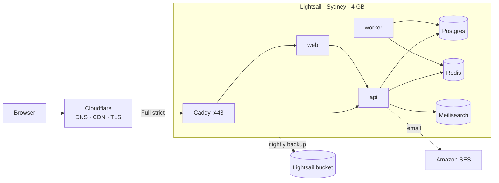

# Deployment — RedReader on Lightsail

> **Status:** setting up · **Last updated:** 2026-11-25
> How production runs, how to release, and how to recover. Pre-launch work is tracked in [production-checklist.md](production-checklist.md).

## How production runs

One Lightsail instance (Ubuntu 24.04, 4 GB RAM, 2 vCPU, 80 GB disk) in **Sydney (`ap-southeast-2`)**, the only Region our AWS project can use. Everything runs in Docker from `/srv/redreader`:

| Service | What it does |
|---|---|
| `caddy` | The only public service (ports 80/443). HTTPS with a Cloudflare Origin Certificate; routes `/api`, `/auth`, `/media`, `/ws` and `/health` to the API and everything else to the web app. |
| `web` | Next.js standalone server (`ghcr.io/lomindil/redreader-web`). |
| `api` | NestJS API (`ghcr.io/lomindil/redreader-api`). |
| `worker` | Background jobs: same image as the API, `node dist/worker.js`. |
| `migrate` | Runs `prisma migrate deploy`, then exits. The API and worker wait for it. |
| `postgres`, `redis`, `meilisearch` | Data services, private to the Docker network, each with its own volume. Redis saves to disk so sign-ins survive restarts. |



Outside the server:
- **Cloudflare:** DNS, caching, DDoS protection, and email forwarding for `hello@`, `partners@` and `grievance@`.
- **Amazon SES:** outgoing email.
- **GitHub Actions and the GitHub container registry:** builds and releases.
- **Google Cloud:** the OAuth client for Google sign-in.

## Production resources (AWS project 896305834989, `ap-southeast-2`)

| Resource | Name | Notes |
|---|---|---|
| Lightsail instance | `redreader-prod` | Ubuntu 24.04, `medium_3_2` (4 GB, $24/mo), `ap-southeast-2a`; automatic snapshots daily 22:00 UTC (03:30 IST), last 7 kept |
| Static IP | `redreader-prod-ip` | Attached to the instance. The address is deliberately not written in the repo; it's in the GitHub secret `DEPLOY_HOST` |
| Firewall | — | 22 open (keys only, no root, fail2ban); 80/443 only from Cloudflare's IP ranges |
| Bucket | `redreader-backups-896305834989` | Private, `small_1_0` ($1/mo, 5 GB); its own access key in `/srv/redreader/backup.env` |
| SSH keys | `redreader-admin` (Lightsail key pair), `github-actions-deploy@redreader` | Private keys in `~/.ssh/` on the owner's machine: `redreader-admin.pem`, `redreader-deploy`. Verified host key in `~/.ssh/redreader_known_hosts` |
| DNS | Cloudflare zone `redreader.in` | `A @` and `CNAME www`, proxied. Mail records are DNS only: Zoho (verification TXT, MX, SPF, DKIM), SES (3 DKIM CNAMEs, `mail` MX and SPF), `_dmarc` |
| SES identity | `redreader.in` | Easy DKIM, MAIL FROM `mail.redreader.in`; account-level suppression for bounces and complaints |
| IAM user | `redreader-ses-smtp` | Only `ses:SendRawEmail` from `*@redreader.in`. Its SMTP credentials (derived from the access key) live only in the server's `SMTP_URL`; rotate by creating a new key, updating `.env`, then deleting the old key |

The project is on the AWS **Free plan** until it's upgraded; see the checklist item about upgrading before the credits run out.

## Releasing

Day-to-day work happens on `main`; CI runs on every push. Production changes only when you release:

```bash
git tag v0.1.0 && git push origin v0.1.0      # or: Actions → Deploy → Run workflow
```

The **Deploy** workflow runs the CI checks, builds both images (tagged `v0.1.0`, `sha-…` and `latest`), copies `deploy/` to the server, then runs `scripts/deploy.sh`. That script pulls the images, restarts what changed (migrations run first), and fails the release if the API doesn't report healthy within about 2 minutes.

**Roll back** by redeploying an earlier tag: on the server, `TAG=v0.0.9 /srv/redreader/scripts/deploy.sh`. (Migrations are forward-only, so a rollback across a migration needs care.)

## First-time setup

| # | Step | Who |
|---|---|---|
| 1 | Re-authenticate the AWS CLI: `aws login --profile lomindil` | You |
| 2 | Create the Lightsail instance (Ubuntu 24.04, 4 GB), a static IP, firewall rules for 22/80/443, and automatic daily snapshots | Claude, with your OK |
| 3 | Move `redreader.in` nameservers to Cloudflare (free plan); add proxied `A` records `@` and `www` → static IP; SSL mode **Full (strict)** | You, with Claude's guidance |
| 4 | Cloudflare → SSL/TLS → Origin Server → Create certificate for `redreader.in, *.redreader.in`; save as `/srv/redreader/certs/origin.pem` and `origin.key` | You (Claude can copy the files) |
| 5 | Copy `deploy/` to the server and run `scripts/bootstrap.sh` | Claude |
| 6 | Google Cloud Console → OAuth client (Web), redirect `https://redreader.in/auth/google/callback`; put the ID and secret in `/srv/redreader/.env` | You |
| 7 | SES: verify `redreader.in` (DKIM via Cloudflare DNS), add SPF/DMARC, request production access, create SMTP credentials → `SMTP_URL` | Claude sets up, you submit the access request |
| 8 | Lightsail bucket `redreader-backups` and an access key → `/srv/redreader/backup.env` | Claude |
| 9 | GitHub → Settings → Secrets: `DEPLOY_HOST`, `DEPLOY_SSH_KEY`, `DEPLOY_KNOWN_HOSTS`; Environments → `production` (optionally require your approval) | You |
| 10 | Commit and push, then tag the first release | You |

## Everyday operations (on the server)

```bash
cd /srv/redreader
docker compose ps                         # what's running
docker compose logs -f --tail 100 api     # follow logs (also: web, worker, caddy)
docker compose exec api node dist/scripts/reindex.js       # rebuild search
docker compose exec api node dist/scripts/enrich-books.js  # fill in book details
scripts/backup.sh                         # back up now
```

**Restore a database dump** (stops the app briefly):

```bash
docker compose stop api worker web
gunzip -c backups/db-YYYYMMDD-HHMM.sql.gz | docker compose exec -T postgres psql -U redreader -d redreader
docker compose up -d
```

## Development vs production (`APP_ENV`)

| | `APP_ENV=development` (local) | `APP_ENV=production` (server) |
|---|---|---|
| Sign-in | Google if configured, plus the simple dev login (any seeded email) | Google only; dev login returns 404 and the API won't start if `DEV_LOGIN=true` |
| Sample data | `pnpm db:seed` / `scripts/start.sh --seed` load sample clubs, users and books | None. The seed script isn't in the image and refuses to run if `APP_ENV` or `NODE_ENV` is production |
| Safety checks | — | Refuses to start without `NODE_ENV=production` or with the default admin password; warns if Google sign-in or SMTP is missing |

`GET /health` reports which one is running (`"env": "production"`). The compose file defaults to production even if the line is missing from `.env`.

## Secrets

The real configuration lives only in `/srv/redreader/.env` (mode 600), created from [`deploy/.env.example`](../deploy/.env.example). `bootstrap.sh` generates the database, search and admin-portal passwords. Backup bucket keys live in `/srv/redreader/backup.env`. Neither file is ever committed. GitHub holds only the SSH deploy key and host details.
